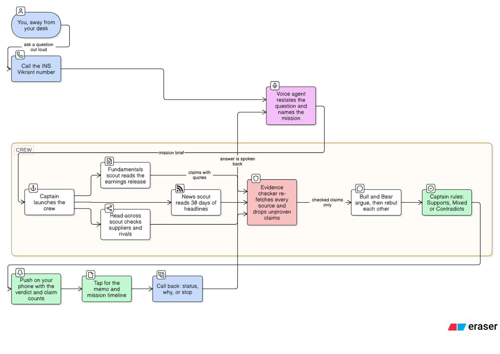

# INS Vikrant

Evidence-checked research missions. Ask a question about a company; three scouts gather claims, a checker written in plain code re-fetches every cited source and drops any claim whose quote is not on the page, Bull and Bear argue from the surviving claims, and a captain rules.

Built for the Boat Hackathon (Nov 2026). Research only: no buy or sell language and no brokerage connection.

## What the caller sees



You call the number and ask a question out loud. The voice agent restates it and starts a mission. A push with the verdict and claim counts lands on your phone, and you can call back to ask for the status or the reasons.

## What runs today

| Part | File | What it does |
|---|---|---|
| Evidence checker | `src/checker.js` | Re-fetches each `source_url`, confirms the quote is on the page after normalising case and whitespace, and confirms every number in the claim is in the quote. No model, so a scraped page cannot talk its way past it. |
| Scouts | `src/scouts.js`, `src/scout-worker.js` | Fundamentals reads the latest 10-Q/10-K from SEC EDGAR; News and Read-across read dated headlines. Each scout runs in its own process. |
| Recorded steps | `src/store.js` | Every mission step writes its result before the next one starts, so a mission resumes instead of restarting. |
| Debate and verdict | `src/debate.js` | Bull and Bear argue from checked claims only, each answers the other's strongest point, and the captain reports counts of claims for and against. There is no confidence score. |
| Mission runner | `src/mission.js` | Runs the steps, relaunches a scout that dies, writes the memo and a per-ticker veto file, and sends an ntfy push. |
| Bridge | `src/bridge.js` | Tool endpoint for a Vapi voice assistant (`start_mission`, `get_status`, `why`, `stop_mission`) and a read-only timeline page. |

## Run it

Requires Node 20 or later. There are no dependencies to install.

```sh
npm test                      # unit tests, no network
npm run fakes                 # planted-fakes measurement against live pages

# a mission, with one scout killed mid-run
node src/mission.js --ticker NVDA --company NVIDIA \
  --question "Do Nvidia's earnings support the AI capex story?" \
  --focus "data center,guidance,revenue" --kill-scout news

# the bridge and the timeline page at http://localhost:8787
BRIDGE_SECRET=change-me npm run bridge
```

### Phone entry point

The phone number is a Vapi assistant whose four tools call the bridge.

```sh
cp .env.example .env            # fill in the values
ngrok http 8787                 # put the https URL in .env as PUBLIC_URL
node --env-file=.env src/bridge.js
node --env-file=.env scripts/setup-vapi.js   # creates the assistant and attaches it to your number
```

If `watchlist.json` lists a ticker, the Fundamentals scout reads those pages; otherwise it looks up the latest filing on SEC EDGAR.

Each mission writes `missions/<id>/`: `brief.json`, `steps/*.json`, `events.jsonl`, `findings.json`, `decision.json` and `memo.md`. The veto file is `veto/<TICKER>.json`.

## Measured numbers

Measured on Nov 20, 2026. Nothing here is estimated.

| Number | Result | How it was measured |
|---|---|---|
| Planted fakes caught | 10 of 10 | `npm run fakes`: 5 invented quotes and 5 real sentences with one number changed, each attached to a real URL |
| Real quotes passed (controls) | 8 of 8 | Same run: real sentences from 4 live pages. A fifth page (sec.gov) was unreachable and skipped |
| Missions that survive a lost scout | 2 of 2 | `--kill-scout news`: the scout process is killed mid-mission, relaunched, and the mission reaches a verdict |
| Claims rejected in live missions | 0 of 28 | Two NVDA missions. The scouts quote pages verbatim, so the checker had nothing to reject; the planted-fakes run is the test of the checker |
| Mission time | about 1.5 s | One NVDA mission, three scouts, 16 claims checked |
| Unit tests | 30 of 30 pass | `npm test` |

A full recorded mission is in [`examples/nvda-capex/`](examples/nvda-capex/): start with [`memo.md`](examples/nvda-capex/memo.md) and `events.jsonl`. Raw planted-fakes output is in `scripts/planted-fakes.result.json`.

## Guards

| Hole | Guard |
|---|---|
| Anyone who finds the bridge URL can call the tools | Every tool call must carry `x-vapi-secret`; the bridge refuses all calls when `BRIDGE_SECRET` is unset |
| Anyone who dials the number can launch a mission | `CALLER_ALLOWLIST` of phone numbers |
| Runaway spend | `DAILY_MISSION_CAP` |
| A scraped page carries instructions | Findings must match the claim schema; the checker is code and compares strings only |
| Destructive voice commands | `stop_mission` needs a spoken yes first |
| Scraped text injecting markup into the timeline | Everything read from disk is HTML-escaped |

## Not built yet

- **Boat VMs.** Scouts run as separate local processes, which stand in for per-mission VMs. Killing a process stands in for deleting a VM.
- **Context.dev and Band.** Scouts and the checker fetch pages directly, and handoffs are function calls recorded in `events.jsonl`, not messages in a Band room.
- **Always-on bridge.** The phone number works while the bridge runs on a laptop behind an ngrok tunnel; it is not hosted on a Boat VM. The tool calls were verified through the public URL with simulated Vapi requests.
- **Model-written arguments.** Scouts, Bull, Bear and the captain are deterministic code. Sides are assigned by keyword counting, which is crude, so there is no model comparison and no replay-accuracy score.
- **Prompt-injection measurement.** Covered by a unit test of the checker only, not by planted pages fed to live scouts.
- **Standing watch.** No monitors or webhooks.
- **Stopping a mission.** `stop_mission` writes a `STOP` flag; the runner does not read it yet.
- **SEC EDGAR lookup.** The filing lookup is written but returned HTTP 403 from the development machine, so the example mission was given NVIDIA's earnings release with `--source`.
